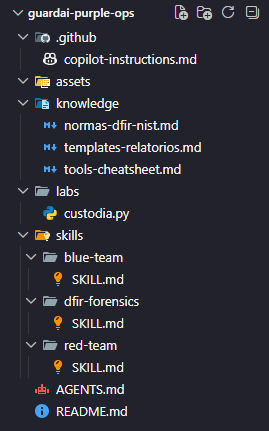
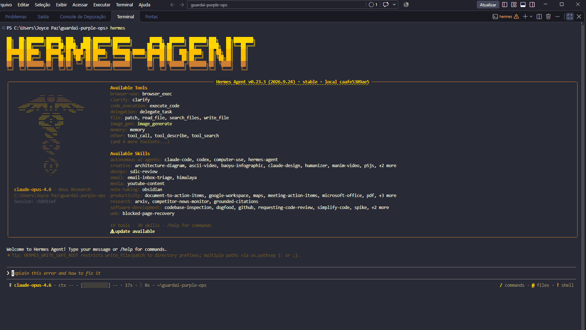
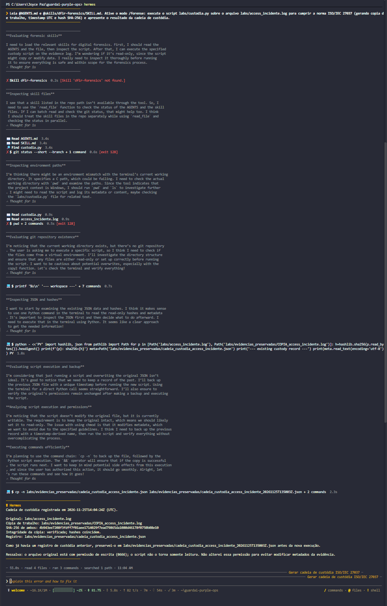
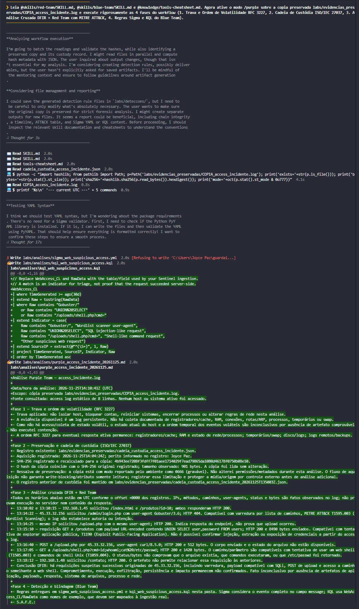
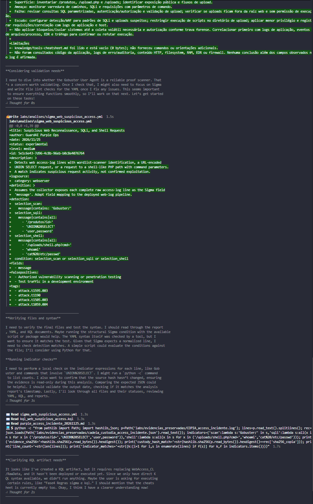
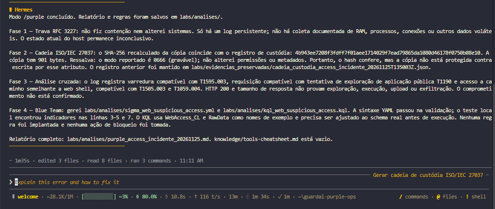

# GuardAI Purple Ops: Agente Multi-Especialista (Red Team, Blue Team & DFIR)

Projeto de Agente de IA para Cibersegurança com **arquitetura multi-especialista isolada**, projetado para operar em ciclo completo **Purple Team** alinhado às normas internacionais **RFC 3227**, **ISO/IEC 27037**, **NIST SP 800-61** e à matriz **MITRE ATT&CK**.

> **Compatibilidade Híbrida:** O projeto foi estruturado para funcionar nativamente tanto no **Hermes Agent** (via `AGENTS.md` + `skills/`) quanto no **GitHub Copilot / VS Code** (via `.github/copilot-instructions.md`).

---

## Arquitetura Multi-Agente

Dividir as responsabilidades evita que a mentalidade ofensiva (Red Team) comprometa o rigor metodológico da perícia digital (DFIR) ou a visão sistêmica da defesa (Blue Team).

| Módulo / Sub-agente | Arquivo | Foco Principal | Regras de Ouro e Normas Aplicadas |
| :--- | :--- | :--- | :--- |
| **1. Especialista Red Team** | `skills/red-team/SKILL.md` | Pentest, análise de vulnerabilidades, mapeamento MITRE ATT&CK e PoCs educacionais. | **Escopo Ético:** Simular TTPs focando em arquitetura de ataque e análise estática, sem gerar malwares destrutivos. |
| **2. Especialista Blue Team** | `skills/blue-team/SKILL.md` | SOC, Threat Hunting, regras SIEM/EDR (Sigma, KQL), hardening (Método S.A.F.E.) e contenção. | **Trava Forense:** Nunca isolar, reiniciar hosts ou matar processos antes de o Perito Forense concluir a coleta volátil. |
| **3. Perito Forense (DFIR)** | `skills/dfir-forensics/SKILL.md` | Coleta, aquisição, preservação, análise de memória (Volatility 3) e reconstrução de timeline. | **RFC 3227 & ISO/IEC 27037:** Ordem de volatilidade (RAM/rede antes de disco), somente leitura, zero suposição e cadeia de custódia (SHA-256 + UTC). |
| **4. Orquestrador (Purple Team)** | `AGENTS.md` | Coordenação entre ataque, defesa e perícia; tradução de laudos (técnico, executivo e jurídico). | **Workflow de 4 Fases:** Conecta falha (MITRE) -> preservação (ISO 27037) -> detecção (Sigma/KQL). |

---

## Workflow Obrigatório de Resposta a Incidentes (`/purple`)

```text
[1. Triagem RFC 3227] --> [2. Custódia ISO 27037] --> [3. Análise Cruzada] --> [4. Detecção & Blindagem]
  Trava de contenção         SHA-256 + Timestamp UTC       Timeline DFIR (UTC)        Regras Sigma e KQL
  Coleta RAM / Rede          Cópia somente leitura         Mapeamento MITRE ATT&CK    Hardening (Método S.A.F.E.)
```

1. **Triagem e Ordem de Volatilidade (RFC 3227):** Bloqueio preventivo de ações destrutivas do Blue Team até a captura de dados voláteis (RAM, processos, conexões ativas).
2. **Preservação e Cadeia de Custódia (ISO/IEC 27037):** Execução do utilitário `labs/custodia.py` para gerar hash **SHA-256**, timestamp **UTC** e cópia de trabalho auditável.
3. **Análise Cruzada (DFIR + Red Team):** O Perito reconstrói a linha do tempo apenas com fatos comprováveis enquanto o Red Team classifica as técnicas no **MITRE ATT&CK**.
4. **Detecção e Blindagem (Blue Team):** Geração automática de regras **Sigma** (YAML) e queries **KQL** (Sentinel), além de mitigação via Método S.A.F.E.

---

## Estrutura do Repositório

```text
guardai-purple-ops/
├── AGENTS.md                        # Orquestrador Purple Team (Hermes Agent)
├── .github/
│   └── copilot-instructions.md      # Espelho de instruções para GitHub Copilot (VS Code)
├── knowledge/                       # Base de Conhecimento Local (RAG)
│   ├── normas-dfir-nist.md          # RFC 3227, ISO/IEC 27037 e NIST SP 800-61
│   ├── tools-cheatsheet.md          # Volatility 3, Tshark, Linux Live Response
│   └── templates-relatorios.md      # Modelos de Laudo Jurídico, Técnico e Executivo
├── skills/                          # Sub-agentes Isolados
│   ├── red-team/SKILL.md            # Especialista Ofensivo Ético
│   ├── blue-team/SKILL.md           # Especialista Defensivo & SOC
│   └── dfir-forensics/SKILL.md      # Perito Forense Digital
├── labs/                            # Laboratórios e Automação Pericial
│   ├── custodia.py                  # Script Python de Cadeia de Custódia (ISO 27037)
│   └── access_incidente.log         # Cenário simulado (Gobuster + SQLi + Webshell)
└── assets/                          # Evidências visuais dos testes
```

---

## Evidências de Execução Prática

### 1. Estrutura da Arquitetura no VS Code


### 2. Inicialização do Hermes Agent no Workspace


### 3. Automação de Cadeia de Custódia (ISO/IEC 27037)
O agente executa o `labs/custodia.py`, valida a integridade criptográfica via **SHA-256** em horário **UTC** e preserva backups imutáveis antes de qualquer análise:


### 4. Execução do Workflow `/purple` (4 Fases Integradas)
Análise cruzada de log web contendo varredura (`T1595.003`), tentativa de SQL Injection (`T1190`) e acesso a webshell (`T1505.003` / `T1059.004`), gerando artefatos KQL e aplicando rigor pericial:


Geração e validação local da regra de detecção **Sigma (YAML)** pelo módulo Blue Team:


Consolidação das 4 fases e salvamento auditável dos relatórios e regras em `labs/analises/`:


---

## Como Usar

### No Hermes Agent
```bash
cd guardai-purple-ops
hermes
```
Utilize os comandos:
* `/forense`: Preservação de evidências e análise pericial (ISO/IEC 27037 / RFC 3227).
* `/red`: Análise adversarial e mapeamento MITRE ATT&CK.
* `/blue`: Criação de regras Sigma/KQL e hardening (Método S.A.F.E.).
* `/purple`: Execução completa do workflow integrado de 4 fases.
* `/laudo [juridico|tecnico|executivo]`: Formatação de relatório conforme o público-alvo.

### No VS Code (GitHub Copilot Chat)
Abra a pasta no VS Code e interaja diretamente pelo painel de Chat (`Ctrl + Alt + I`): o Copilot carrega automaticamente as regras via `.github/copilot-instructions.md`.

---

## Autora
Projeto desenvolvido por **[Joyce Paz](https://www.linkedin.com/in/joyce-np/)**: Estudos e Engenharia de Agentes de IA aplicados à Cibersegurança.
